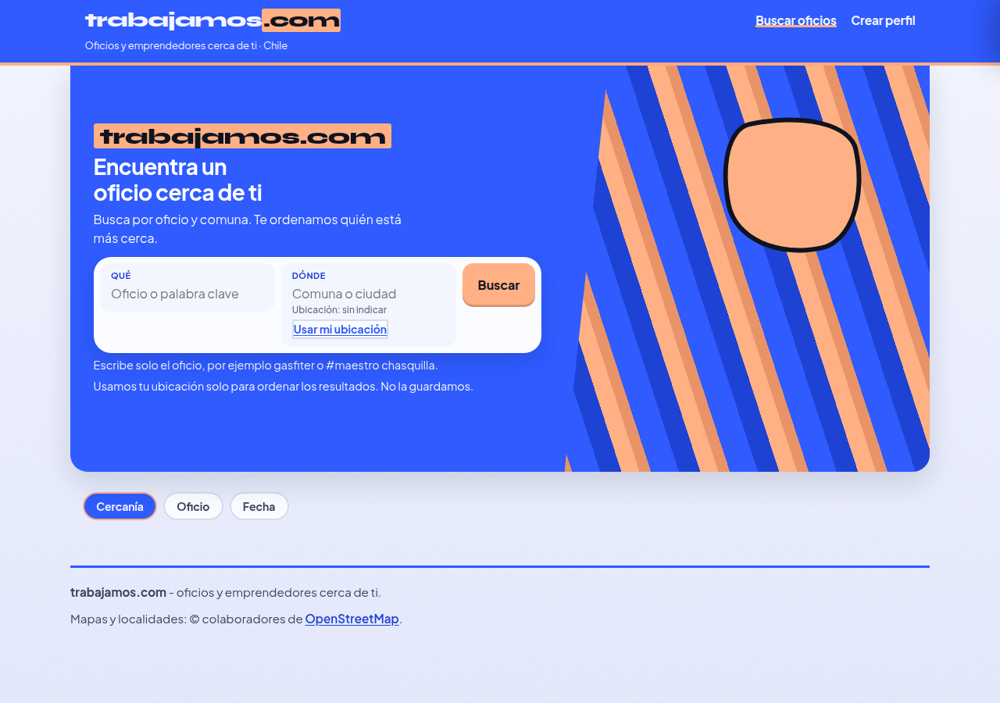
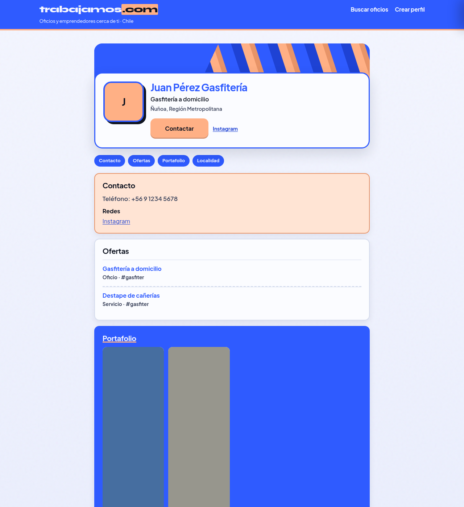

# Cobalto — paleta cobalt + apricot

| Campo | Valor |
| :--- | :--- |
| Agente | Cobalto |
| Rama | `cursor/look-c-color-cobalto-aa58` @ `a96a816415038ee6a3eebfa45480c104482eeb9b` |
| Base | C3 Jakarta · `cursor/look-c-tipo-jakarta-aa58` @ `0d3578ce` |
| Veredicto | Variante cerrada (firma visual del Arquitecto pendiente) |
| Tests | 64/64 |
| Capturas | Inicio, perfil y mobile |

## Skills asignadas

Mismo set que Coral. Cambia la paleta.

| Orden | Skill | Uso concreto |
| :--- | :--- | :--- |
| 1 | **design-taste-frontend** | Eje color: cobalt `#2f5bff` + apricot `#ffb085` + ink `#0e1320` + paper `#f4f6ff` |
| 2 | **redesign-existing-projects** (`redesign-skill`) | Contraste y CTAs sobre la UI de C3 |

Tipo bloqueado en C3 (Syne solo logo, Plus Jakarta Sans en la UI). Layout, ids y contrato Contactar sin rediseño.

## Tokens de este experimento

| Rol | Valor |
| :--- | :--- |
| Cobalt | `#2f5bff` |
| Apricot | `#ffb085` |
| Ink | `#0e1320` |
| Paper | `#f4f6ff` |
| Tipo | Candado C3 (Jakarta) |
| Banner | Stripe drift CSS (`translate3d` de un periodo); `prefers-reduced-motion` congela el fotograma |

## Banner

El banner deja de ser estático. La deriva es un **stripe drift**: un periodo del patrón se desplaza con `transform: translate3d`. Sin video ni librería de motion. Con `prefers-reduced-motion: reduce` la animación no corre y el banner queda quieto.

## Capturas

| Vista | Archivo |
| :--- | :--- |
| Inicio | [capturas/look-c-color-cobalto-inicio.png](capturas/look-c-color-cobalto-inicio.png) |
| Perfil | [capturas/look-c-color-cobalto-perfil.png](capturas/look-c-color-cobalto-perfil.png) |
| Mobile | [capturas/look-c-color-cobalto-mobile.png](capturas/look-c-color-cobalto-mobile.png) |

