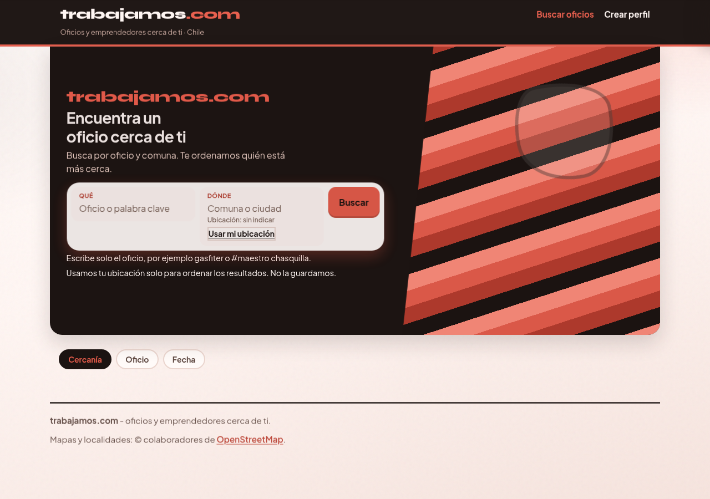
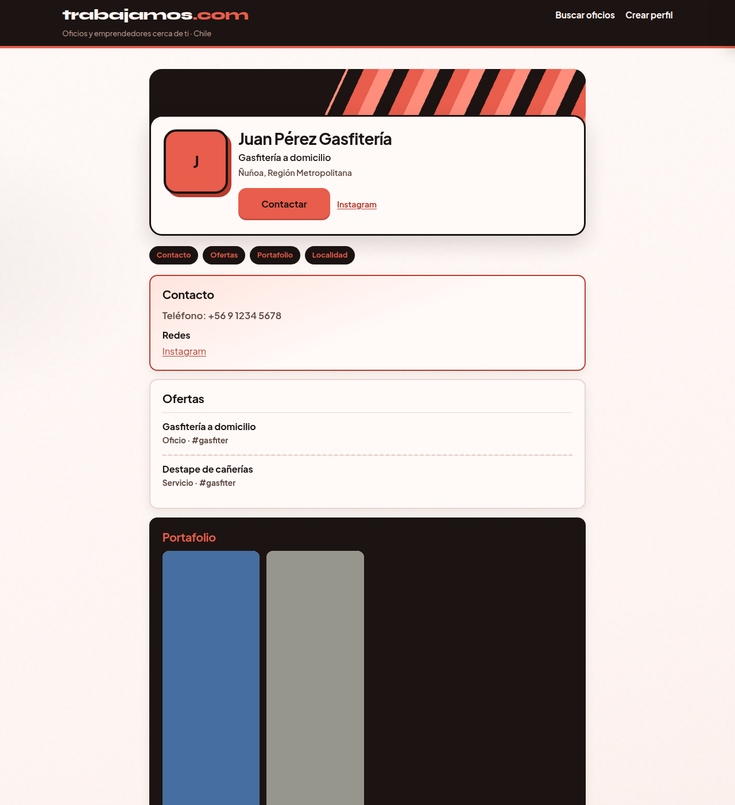

# Coral — paleta coral + ink

| Campo | Valor |
| :--- | :--- |
| Agente | Coral |
| Rama | `cursor/look-c-color-coral-aa58` @ `47da9ba5aa04561f6d0ba07c9cbab944b408f70a` |
| Base | C3 Jakarta · `cursor/look-c-tipo-jakarta-aa58` @ `0d3578ce` |
| Veredicto | Variante cerrada (firma visual del Arquitecto pendiente) |
| Tests | 64/64 |
| Capturas | Inicio, perfil y mobile |

## Skills asignadas

| Orden | Skill | Uso concreto |
| :--- | :--- | :--- |
| 1 | **design-taste-frontend** | Eje color: coral `#e85d4c` + ink `#1c1412` + paper `#fff6f3` |
| 2 | **redesign-existing-projects** (`redesign-skill`) | Contraste y CTAs sobre la UI de C3 |

Tipo bloqueado en C3 (Syne solo logo, Plus Jakarta Sans en la UI, escala 14/16/20/28). Layout, ids y contrato Contactar sin rediseño.

## Tokens de este experimento

| Rol | Valor |
| :--- | :--- |
| Coral | `#e85d4c` |
| Ink | `#1c1412` |
| Paper | `#fff6f3` |
| Tipo | Candado C3 (Jakarta) |
| Banner | Stripe drift CSS (`translate3d`); `prefers-reduced-motion` congela el fotograma |

## Banner

El banner deja de ser estático. La deriva es un **stripe drift**: un `::before` más ancho que el recorte se mueve con `transform: translate3d`. Sin video ni librería de motion. Con `prefers-reduced-motion: reduce` la animación no corre (`animation: none`) y el banner queda quieto.

## Capturas

| Vista | Archivo |
| :--- | :--- |
| Inicio | [capturas/look-c-color-coral-inicio.png](capturas/look-c-color-coral-inicio.png) |
| Perfil | [capturas/look-c-color-coral-perfil.png](capturas/look-c-color-coral-perfil.png) |
| Mobile | [capturas/look-c-color-coral-mobile.png](capturas/look-c-color-coral-mobile.png) |

