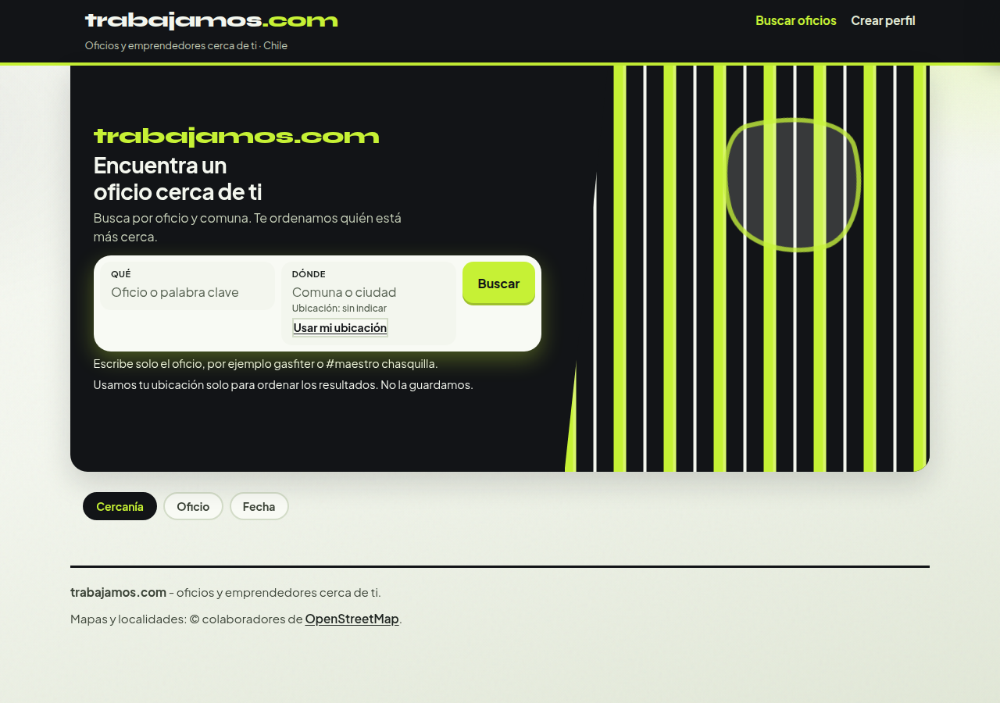
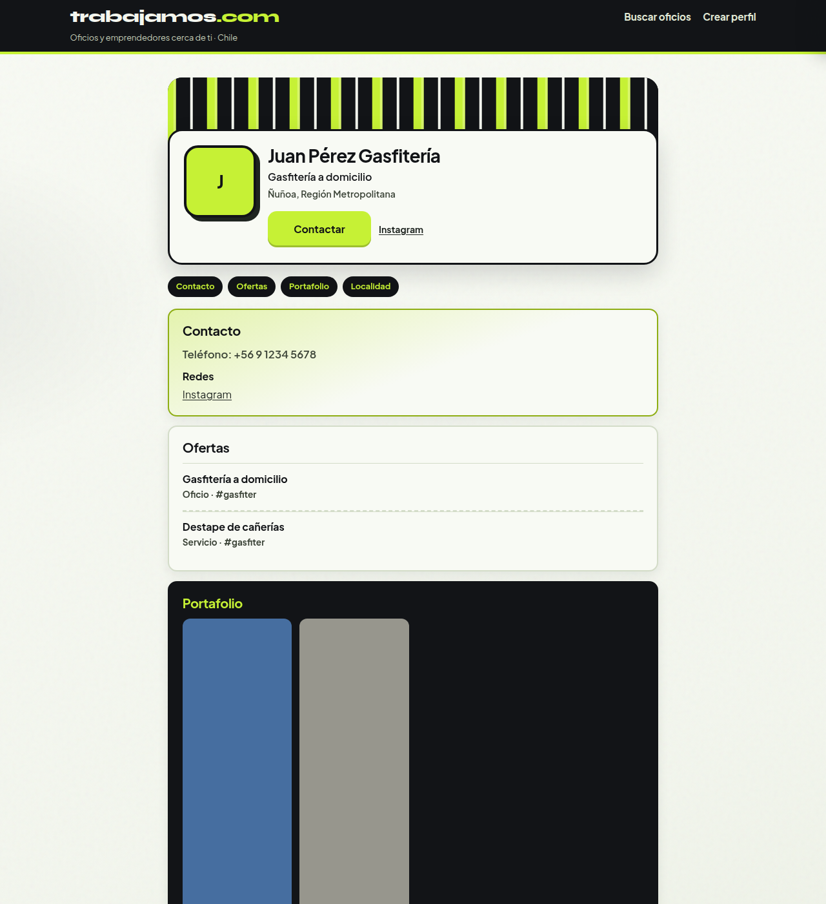

# Lima — paleta electric lime + charcoal

| Campo | Valor |
| :--- | :--- |
| Agente | Lima |
| Rama | `cursor/look-c-color-lima-aa58` @ `9616a1386ad47db54ea6caf77e305d5e83dcdb6c` |
| Base | C3 Jakarta · `cursor/look-c-tipo-jakarta-aa58` @ `0d3578ce` |
| Veredicto | Variante archivada (firma visual del Arquitecto pendiente) |
| Tests | 64/64 |
| Capturas | Inicio, perfil y mobile |

## Skills asignadas

Mismo set que Coral y Cobalto, sobre el candado C3 Jakarta. Cambia la paleta y el banner.

| Orden | Skill | Uso concreto |
| :--- | :--- | :--- |
| 1 | **design-taste-frontend** | Eje color: electric lime `#c6f135` + charcoal `#121417` + mist `#f3f6ee` |
| 2 | **redesign-existing-projects** (`redesign-skill`) | Contraste y CTAs sobre la UI de C3 |

Tipo bloqueado en C3 (Syne solo logo, Plus Jakarta Sans en la UI). Layout, ids y contrato Contactar sin rediseño.

## Tokens de este experimento

| Rol | Valor |
| :--- | :--- |
| Electric lime | `#c6f135` |
| Charcoal | `#121417` |
| Mist | `#f3f6ee` |
| Tipo | Candado C3 (Jakarta) |
| Banner | `lima-drift`: `translate3d` de un periodo de 64px + brillo mist + blob en el hero; `prefers-reduced-motion` congela el fotograma |

## Banner

El banner deja de ser estático. La animación se llama **lima-drift**: un periodo de 64px se desplaza con `transform: translate3d`, con un brillo de mist y un blob en el hero. Sin video ni librería de motion. Con `prefers-reduced-motion: reduce` la animación no corre y el banner queda quieto.

## Capturas

| Vista | Archivo |
| :--- | :--- |
| Inicio | [capturas/look-c-color-lima-inicio.png](capturas/look-c-color-lima-inicio.png) |
| Perfil | [capturas/look-c-color-lima-perfil.png](capturas/look-c-color-lima-perfil.png) |
| Mobile | [capturas/look-c-color-lima-mobile.png](capturas/look-c-color-lima-mobile.png) |

