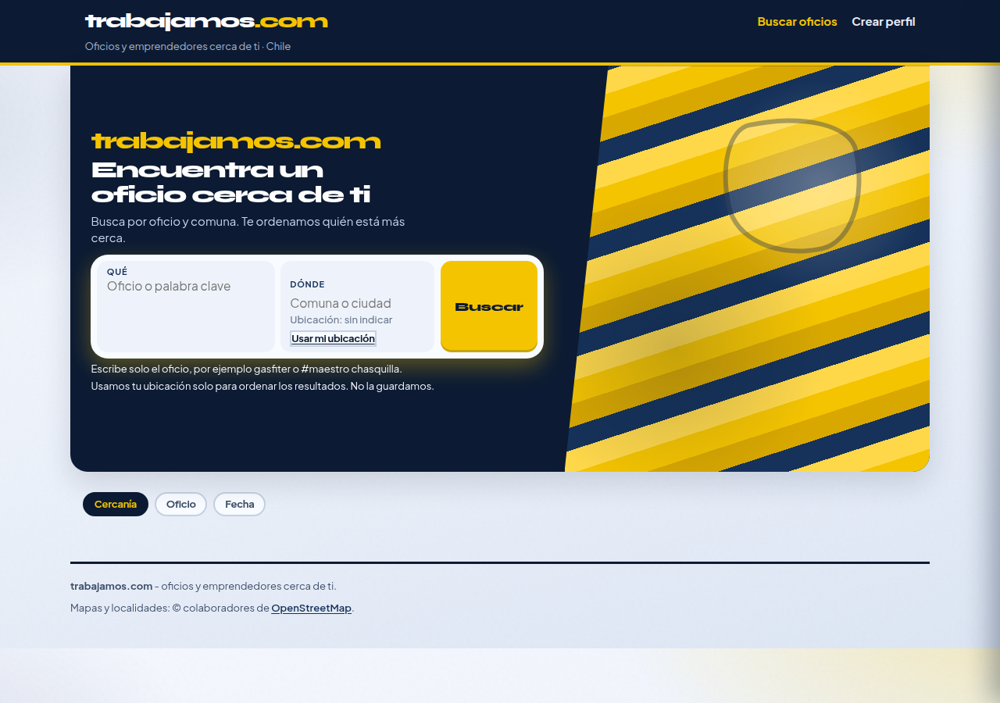
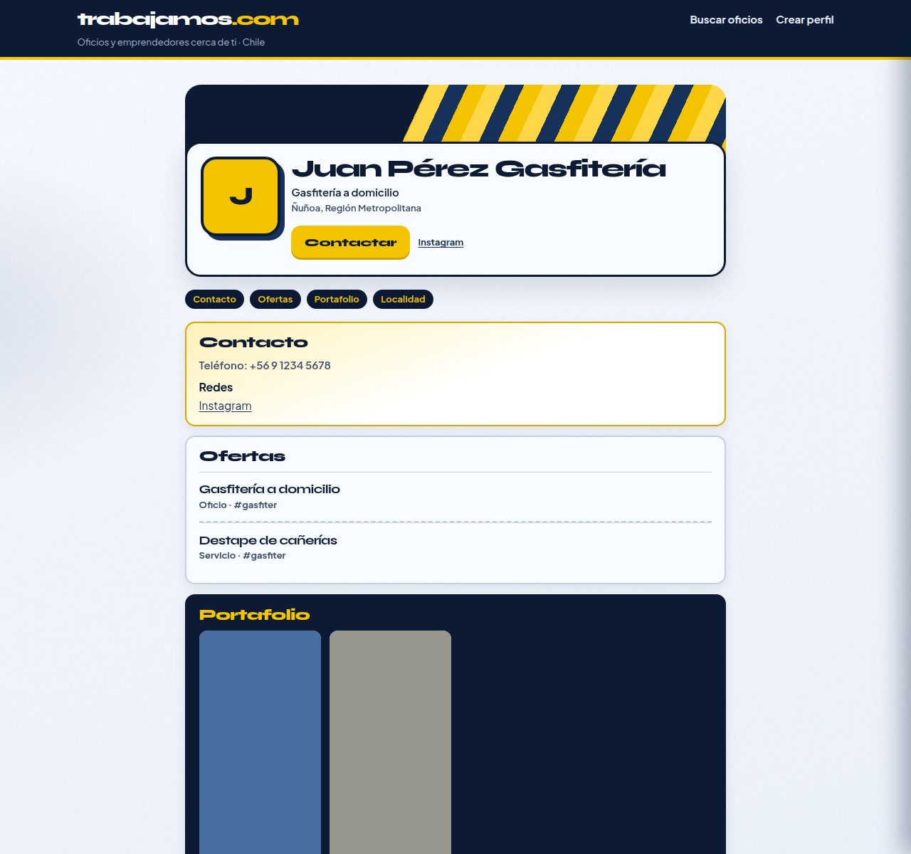

# C1 — Syne denso (alternativa archivada)

| Campo | Valor |
| :--- | :--- |
| Fecha | 2026-11-03 |
| Rama | `cursor/look-c-tipo-syne-aa58` @ `8542b742` |
| Base | `cursor/look-colorido-aa58` |
| Veredicto | Alternativa archivada (no es el candado) |
| Tests | 64/64 |

## Skills

Fork **solo de tipo** de Look C. No hay skill nueva.

| Orden | Skill | Uso concreto |
| :--- | :--- | :--- |
| 1 | **design-taste-frontend** | Dials de Look C sin cambio; la paleta sunflower + navy queda intacta |
| 2 | **redesign-existing-projects** (`redesign-skill`) | Ajuste de tracking, clamps y densidad de cuerpo para que el tipo quepa |
| 3 | **indeed-cl-inspired** + **linkedin-profile-inspired** | Solo IA de contenido, igual que Look C |

## Qué cambió

Syne sigue siendo display; Plus Jakarta Sans sigue siendo cuerpo. Se aprieta la escala para que Qué/Dónde, CTAs, cards y el nombre de perfil quepan a 390 px y 1280 px.

| Rol | Cara | Tamaño | Tracking |
| :--- | :--- | :--- | :--- |
| Cuerpo | Plus Jakarta Sans | `0.96875rem` (15.5px), LH 1.42 | — |
| Meta / ayuda / tag | Plus Jakarta Sans | `0.8125rem` (13px), LH 1.35 | — |
| Logo header | Syne 800 | `clamp(1.25–1.55rem)` | `-0.06em` |
| Marca hero | Syne 800 | `clamp(1.35–1.85rem)` | `-0.06em` |
| H1 página | Syne 800 | `clamp(1.65–2.4rem)` | `-0.055em` |
| H1 hero (`#buscar-titulo`) | Syne 800 | `clamp(1.3–1.85rem)` | `-0.055em` |
| Nombre de perfil | Syne 800 | `clamp(1.45–2.05rem)` | `-0.055em` |
| H2 | Syne 800 | `clamp(1.15–1.3rem)` | `-0.04em` |
| Título de card / oferta | Syne 800 | `clamp(1.05–1.15rem)` | `-0.04em` |

Ajustes de encaje (sin rediseño de color ni de layout de concepto): grilla de búsqueda con `minmax(0,1fr)` y ellipsis en el input; `text-wrap: pretty` en títulos; CTAs más densos; columnas de resultados con `min-width: 0`.

## Capturas

| Vista | Archivo |
| :--- | :--- |
| Inicio | [capturas/look-c-tipo-syne-inicio.png](capturas/look-c-tipo-syne-inicio.png) |
| Resultados | [capturas/look-c-tipo-syne-resultados.png](capturas/look-c-tipo-syne-resultados.png) |
| Perfil | [capturas/look-c-tipo-syne-perfil.png](capturas/look-c-tipo-syne-perfil.png) |
| Mobile | [capturas/look-c-tipo-syne-mobile.png](capturas/look-c-tipo-syne-mobile.png) |

