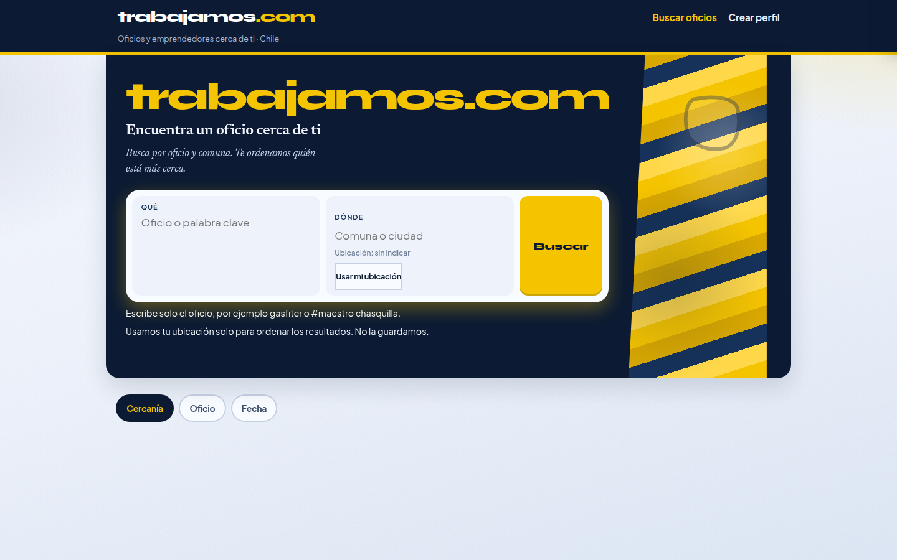
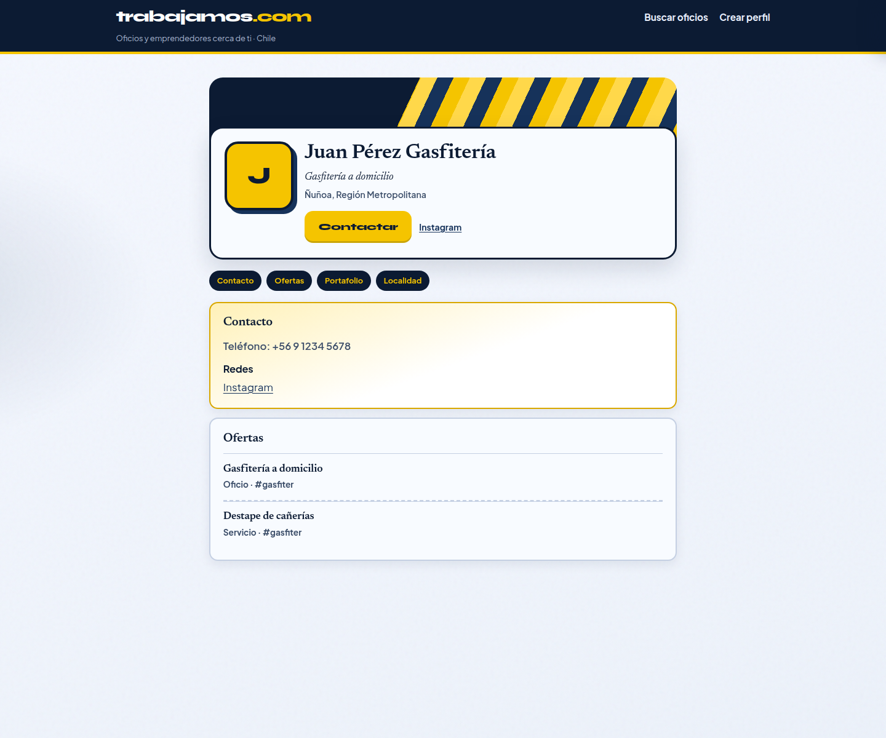

# C2 — Editorial Newsreader (alternativa archivada)

| Campo | Valor |
| :--- | :--- |
| Fecha | 2026-11-03 |
| Rama | `cursor/look-c-tipo-editorial-aa58` @ `e9a803dc` |
| Base | `cursor/look-colorido-aa58` |
| Veredicto | Alternativa archivada (no es el candado) |
| Tests | 64/64 |

## Skills

Fork **solo de tipo** de Look C. No hay skill nueva. Newsreader entra como cara de títulos, no como skill de dirección.

| Orden | Skill | Uso concreto |
| :--- | :--- | :--- |
| 1 | **design-taste-frontend** | Dials y paleta de Look C intactos |
| 2 | **redesign-existing-projects** (`redesign-skill`) | Pareja editorial: marca display + títulos serif + cuerpo UI |
| 3 | **indeed-cl-inspired** + **linkedin-profile-inspired** | Solo IA de contenido, igual que Look C |

## Qué cambió

| Rol | Cara | Notas |
| :--- | :--- | :--- |
| Marca (hero, nav, CTAs) | **Syne** 800 | `clamp(2.55rem … 3.85rem)` en `.tw-hero__brand`, tracking `-0.055em`, LH `0.92` |
| Títulos / display | **Newsreader** 400–700 | `--fs-title` `clamp(1.2rem … 1.65rem)`, tracking `-0.012em` |
| Titular del hero | Newsreader 600 | Subordinado a la marca (`clamp(1.12rem … 1.48rem)`) |
| Lead del hero | Newsreader italic 400 | `1.02rem`, LH `1.55` |
| Título de card | Newsreader 600 | `1.05rem`, más cerrado |
| Cuerpo / meta / UI | **Plus Jakarta Sans** | Cuerpo `1.0625rem`; meta de card `0.82rem`; labels `0.7–0.75rem` |

Encaje: más aire entre marca y título en el hero; resultados más densos (padding de card `0.72rem`, gap de lista `0.55rem`); en móvil la búsqueda apila a una columna y campos/CTAs respetan `min-height: 44px`.

Sin Inter, sin purple, sin cambio de color.

## Capturas

| Vista | Archivo |
| :--- | :--- |
| Inicio | [capturas/look-c-tipo-editorial-inicio.png](capturas/look-c-tipo-editorial-inicio.png) |
| Resultados | [capturas/look-c-tipo-editorial-resultados.png](capturas/look-c-tipo-editorial-resultados.png) |
| Perfil | [capturas/look-c-tipo-editorial-perfil.png](capturas/look-c-tipo-editorial-perfil.png) |
| Mobile | [capturas/look-c-tipo-editorial-mobile.png](capturas/look-c-tipo-editorial-mobile.png) |

