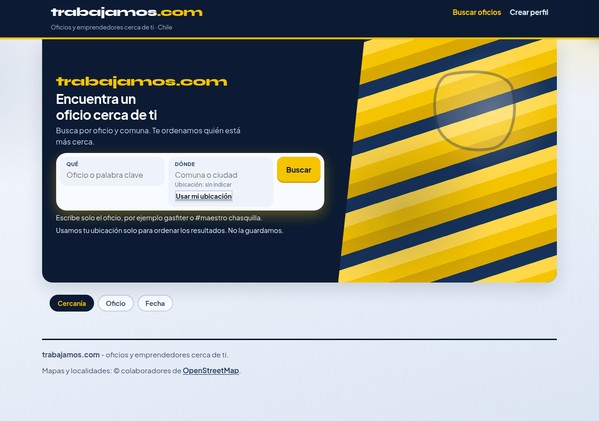
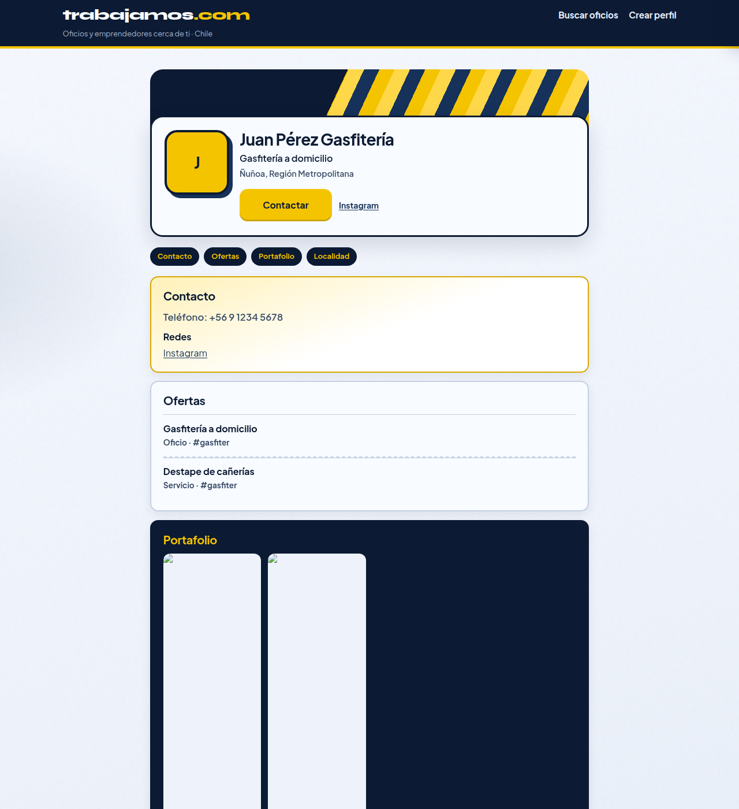

# C3 — Jakarta (candado tipográfico)

| Campo | Valor |
| :--- | :--- |
| Fecha | 2026-11-03 |
| Rama | `cursor/look-c-tipo-jakarta-aa58` @ `0d3578ce` |
| Base | `cursor/look-colorido-aa58` |
| Veredicto | **Seleccionado** como candado de tipo sobre Look C |
| Tests | 64/64 |

Los experimentos de color (Coral, Lima, Cobalto) parten de este fork: skills y paletas en [look-c-colores/](../../look-c-colores/README.md). C1 y C2 quedan archivados.

## Skills

Fork **solo de tipo** de Look C. No hay skill nueva.

| Orden | Skill | Uso concreto |
| :--- | :--- | :--- |
| 1 | **design-taste-frontend** | Dials y paleta sunflower `#f5c400` + navy `#0c1b33` intactos |
| 2 | **redesign-existing-projects** (`redesign-skill`) | Syne deja de ser display de UI; Jakarta pasa a cara de producto |
| 3 | **indeed-cl-inspired** + **linkedin-profile-inspired** | Solo IA de contenido, igual que Look C |

## Qué cambió

| Token | Valor | Rol |
| :--- | :--- | :--- |
| `--font-logo` | Syne | Solo logo y marca del hero (`trabajamos` / `trabajamos.com`) |
| `--font-ui` / cuerpo | Plus Jakarta Sans | Títulos, CTAs, cards, perfil, chips, botones |
| Escala | 14 / 16 / 20 / 28 | `--fs-sm` / `--fs-base` / `--fs-md` / `--fs-lg` |
| Tracking | `0` en cuerpo; `-0.02em` en títulos grandes | Densidad de producto predecible |

Ajustes de encaje (tipo, no de color):

- h1–h3, cards, CTAs, perfil, chips y botones pasan de Syne display a Jakarta.
- Títulos de card y H1 de perfil: clamp a 2 líneas, sin choque con el badge de km ni con Contactar.
- Franja de búsqueda: campos y CTA a la misma altura (`3.5rem`), baselines de label e input alineados.
- Móvil 390×844: marca, título y lead del hero más chicos y splash más corto, para que Qué / Dónde / Buscar queden above the fold.

Colores, concepto de layout, ids y contrato Contactar sin cambio.

## Capturas

| Vista | Archivo |
| :--- | :--- |
| Inicio | [capturas/look-c-tipo-jakarta-inicio.png](capturas/look-c-tipo-jakarta-inicio.png) |
| Resultados | [capturas/look-c-tipo-jakarta-resultados.png](capturas/look-c-tipo-jakarta-resultados.png) |
| Perfil | [capturas/look-c-tipo-jakarta-perfil.png](capturas/look-c-tipo-jakarta-perfil.png) |
| Mobile | [capturas/look-c-tipo-jakarta-mobile.png](capturas/look-c-tipo-jakarta-mobile.png) |

