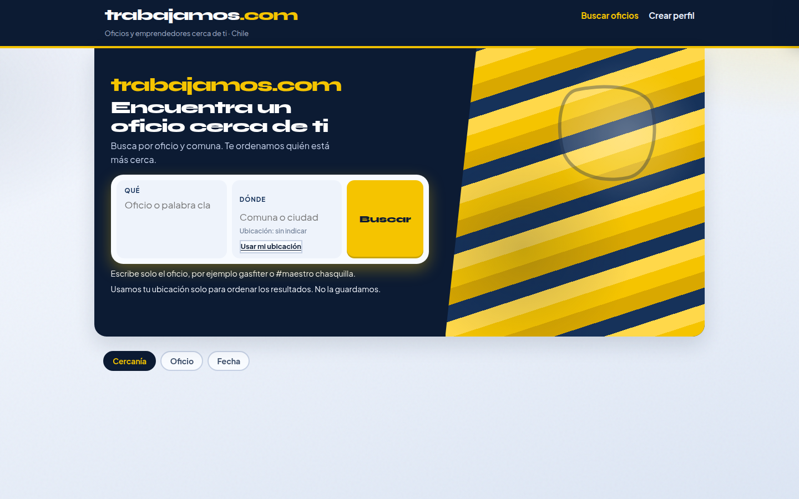
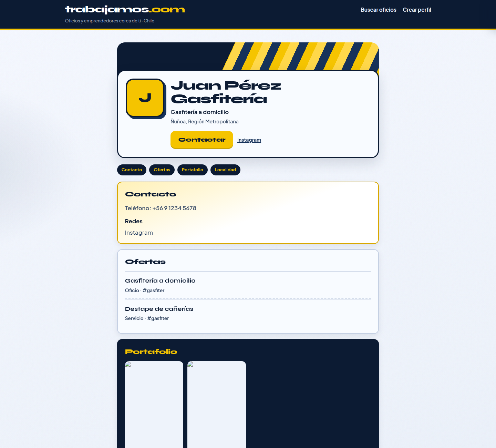

# Look C — Moderno colorido (sunflower + navy)

| Campo | Valor |
| :--- | :--- |
| Fecha | 2026-11-03 |
| Rama | `cursor/look-colorido-aa58` @ `3489dcab` |
| Veredicto | Pendiente (Arquitecto) |
| Tests | 64/64 |

## Skills ocupadas

| Orden | Skill | Repo / ruta | Uso concreto |
| :--- | :--- | :--- | :--- |
| 1 | **design-taste-frontend** (`taste-skill`) | `web-design/external/taste-skill/skills/taste-skill/SKILL.md` | Dials VARIANCE ~8–9 · MOTION ~7–8 · DENSITY ~4–5; anti-default (sin purple AI) |
| 2 | **redesign-existing-projects** | `web-design/external/taste-skill/skills/redesign-skill/SKILL.md` | Jerarquía, CTAs, contraste |
| 3 | **indeed-cl-inspired** + **linkedin-profile-inspired** | `proyectos/web/trabajamos-com/skills/…` | Solo **orden de contenido** (búsqueda → resultados → perfil); **no** su piel corporativa |

## Tokens

| Rol | Valor |
| :--- | :--- |
| Navy | `#0c1b33` / mid `#16325a` |
| Sunflower | `#f5c400` (CTAs, badges, riel) |
| Paper | `#eef3fb` |
| Tipo (base de este commit) | Syne display · Plus Jakarta Sans cuerpo |
| Candado de tipo | **C3 Jakarta** — ver [look-c-tipo/](../look-c-tipo/README.md). C1 Syne denso y C2 Newsreader archivados |

## Capturas

| Vista | Archivo |
| :--- | :--- |
| Inicio | [capturas/look-colorido-inicio.png](capturas/look-colorido-inicio.png) |
| Resultados | [capturas/look-colorido-resultados.png](capturas/look-colorido-resultados.png) |
| Perfil | [capturas/look-colorido-perfil.png](capturas/look-colorido-perfil.png) |
| Mobile | [capturas/look-colorido-mobile.png](capturas/look-colorido-mobile.png) |

## Evitado

Purple-indigo AI, glow, emoji UI, Inter como marca, cream+terracotta+serif, Soft Structuralism teal isla, sage orgánico 4b, skins Indeed/LinkedIn.
