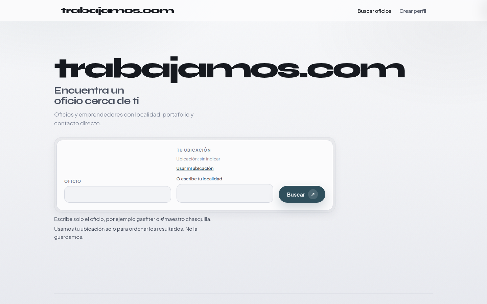
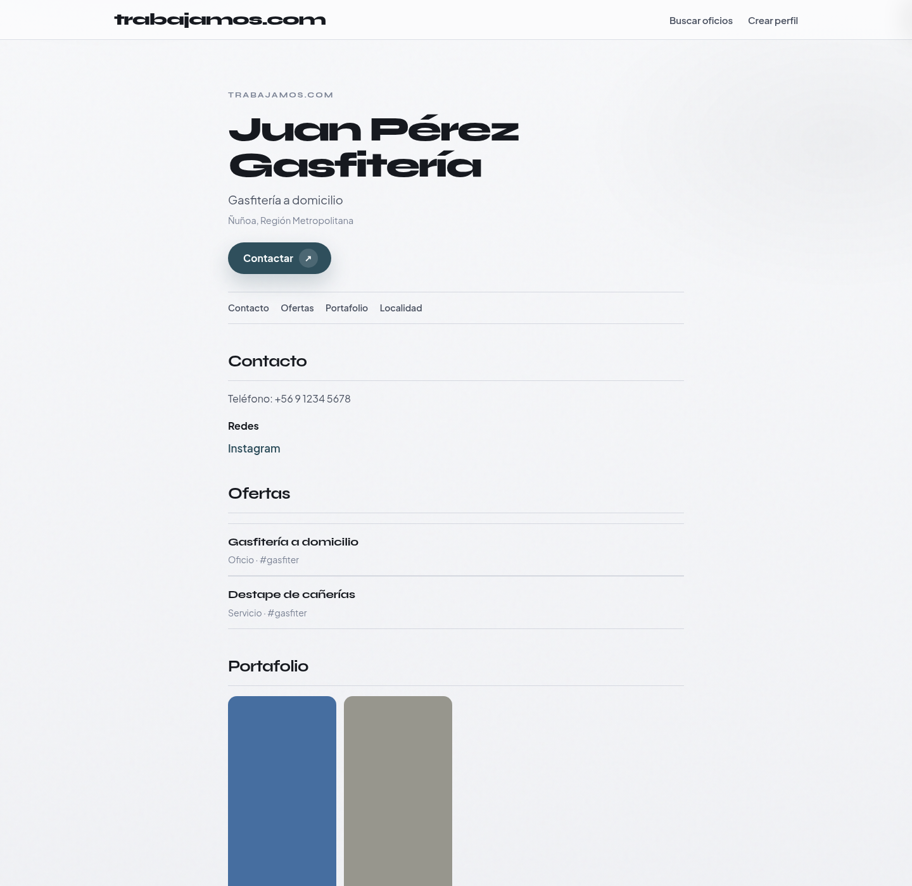

# Look B — Elegante (Pearl Soft Structuralism)

| Campo | Valor |
| :--- | :--- |
| Fecha | 2026-11-03 |
| Rama | `cursor/look-elegante-aa58` @ `2e1e6b17` |
| Veredicto | Pendiente (Arquitecto) |
| Tests | 64/64 |

## Skills ocupadas

| Orden | Skill | Repo / ruta | Uso concreto |
| :--- | :--- | :--- | :--- |
| 1 | **high-end-visual-design** (`soft-skill`) | `web-design/external/taste-skill/skills/soft-skill/SKILL.md` | Principios Soft Structuralism: aire, tipografía presente, un acento, motion suave — expresión **Pearl** (no recrea prueba 3) |
| 2 | **design-taste-frontend** (`taste-skill`) | `web-design/external/taste-skill/skills/taste-skill/SKILL.md` | Dials VARIANCE ~5–6 · MOTION ~4–5 · DENSITY ~3 |
| 3 | **redesign-existing-projects** | `web-design/external/taste-skill/skills/redesign-skill/SKILL.md` | Anti-slop; limpieza de chrome |

*Nota:* skills de producto Indeed/LinkedIn **no** definen este look (se evita su anatomía densa / top-card).

## Tokens

| Rol | Valor |
| :--- | :--- |
| Papel | `#f2f3f6` |
| Tinta | `#16191f` |
| Acento | pizarra oceánica `#2f4f5c` |
| Tipo | Syne · Plus Jakarta Sans |
| Superficies | Double-bezel suave; lista editorial con hairlines |

## Capturas

| Vista | Archivo |
| :--- | :--- |
| Inicio | [capturas/look-elegante-inicio.png](capturas/look-elegante-inicio.png) |
| Resultados | [capturas/look-elegante-resultados.png](capturas/look-elegante-resultados.png) |
| Perfil | [capturas/look-elegante-perfil.png](capturas/look-elegante-perfil.png) |
| Mobile | [capturas/look-elegante-mobile.png](capturas/look-elegante-mobile.png) |

## Evitado

Prueba 3: island glass, purple ethereal, OLED. Cluster cream+terracotta+serif. Gradientes morados. Anatomía job-board / LinkedIn top-card.
