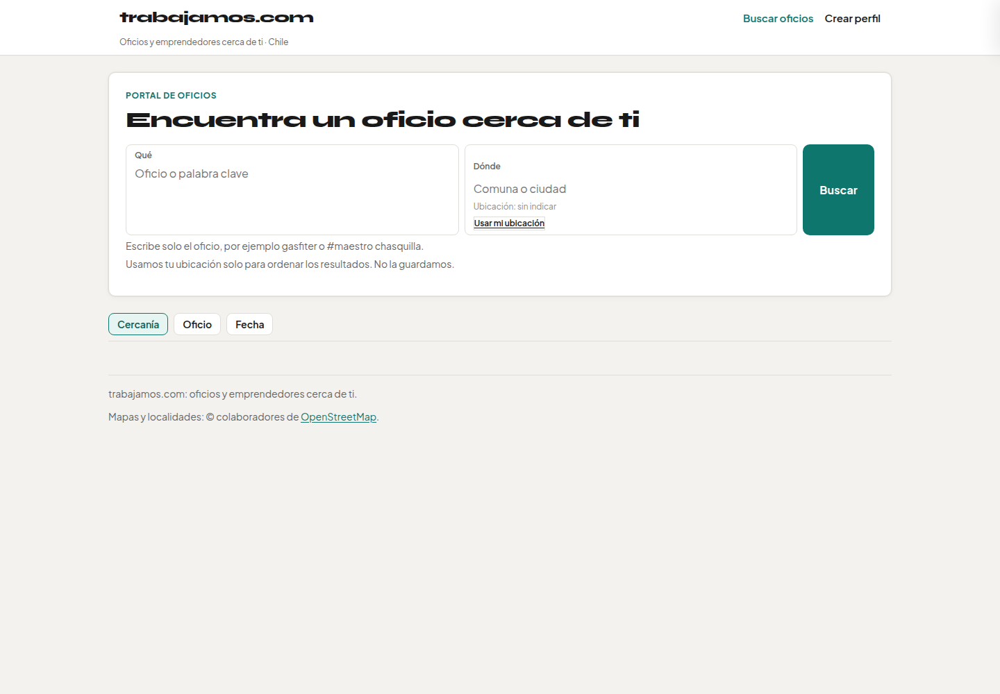
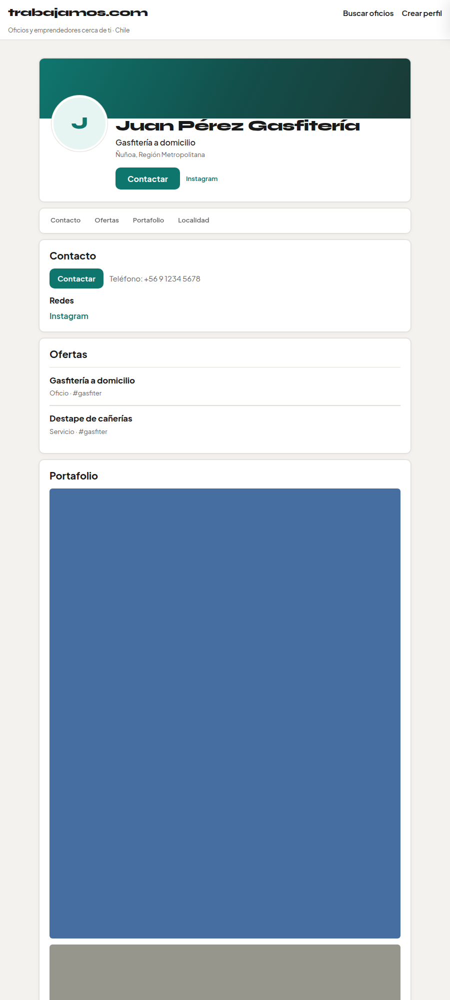

# Look A — LinkedIn / perfil profesional

| Campo | Valor |
| :--- | :--- |
| Fecha | 2026-11-03 |
| Rama | `cursor/look-linkedin-aa58` @ `4f61acea` |
| Commit proyecto | `proyectos` |
| Veredicto | Pendiente (Arquitecto) |
| Tests | 64/64 |

## Skills ocupadas

| Orden | Skill | Repo / ruta | Uso concreto |
| :--- | :--- | :--- | :--- |
| 1 | **linkedin-profile-inspired** | `proyectos/web/trabajamos-com/skills/linkedin-profile-inspired/SKILL.md` | Top-card: banner + inicial overlapping, H1, headline, localidad, **Contactar** en hero; TOC; secciones en bloques; portafolio rail |
| 2 | **indeed-cl-inspired** | `proyectos/web/trabajamos-com/skills/indeed-cl-inspired/SKILL.md` | Home search-first Qué/Dónde + Buscar; cards densas título → empresa → distancia → meta |
| 3 | **redesign-existing-projects** | `web-design/external/taste-skill/skills/redesign-skill/SKILL.md` | Un acento, neutrales coherentes, sin glass/pill AI |

## Tokens

| Rol | Valor |
| :--- | :--- |
| Wash | `#f4f2ee` |
| Surface | `#ffffff` |
| Border | `#e0ded8` |
| Text | `#191919` / `#666666` |
| Acento | teal `#0f766e` |
| Tipo | Syne (marca/H1) · Plus Jakarta Sans (UI) |
| Radio | 8–10px |

## Capturas

| Vista | Archivo |
| :--- | :--- |
| Inicio | [capturas/look-linkedin-inicio.png](capturas/look-linkedin-inicio.png) |
| Resultados | [capturas/look-linkedin-resultados.png](capturas/look-linkedin-resultados.png) |
| Perfil | [capturas/look-linkedin-perfil.png](capturas/look-linkedin-perfil.png) |
| Mobile | [capturas/look-linkedin-mobile.png](capturas/look-linkedin-mobile.png) |

## Evitado

Azul job-board Indeed; cream+terracotta+serif; Soft Structuralism isla/glass; grain orgánico 4b; marcas LinkedIn/Indeed en UI.
